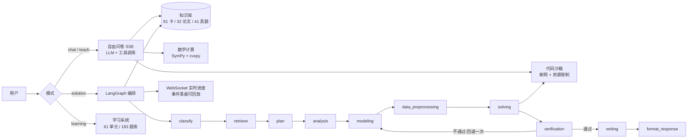

# 答辩演示脚本（5–8 分钟 · 无 PPT · 真实系统演示）

> 适用场景：复试「真实系统演示」，不准备 PPT，Word 说明文档另交（专家人手一份）。
> 设计原则：**每一秒都在证明「这是真系统」**——所以全程真点、真等、真出错也行，
> 不切录屏（除非触发第三节的风险预案）。
> 核心理念贯穿全场：**AI 辅助不是替你写完，而是把过程变得可观测、可回退、可验证。**

---

## 〇、时间分配总表

| 段 | 内容 | 时长 | 累计 | 对应评分点 |
|----|------|------|------|-----------|
| 0 | 开场定位（首页 + 三个数字） | 0:45 | 0:45 | 设计理念 |
| 1 | 对话模式：粒子群优化算法动画演示 | 1:45 | 2:30 | 功能 + RAG/工具调用 |
| 2 | 方案模式：2023 国赛 C 题（**提前跑好**） | 2:45 | 5:15 | 逻辑（核心） |
| 3 | 亮点收尾：安全 + 工程质量 | 1:15 | 6:30 | 亮点 |
| — | 预留缓冲 | 1:30 | 8:00 | — |

**目标 6 分半，硬上限 8 分钟。** 若第 2 段超时，砍第 3 段的「测试数量」一句，保「安全」两句。

### 已备好的演示素材（2026-10-14 实测）

| 素材 | 实测数据 |
|------|----------|
| 粒子群动画 GIF | 1300×550、80 帧、120ms/帧、945 KB，32.5 秒生成；持久化在 `backend/data/chat_images/a9bddbf4/pso_demo.gif` |
| 方案模式任务 | `task_id = 579b79d0`，2023 国赛 C 题，**completed**，920 条事件、6 张图、论文 73,243 字、交付 ZIP 5.19 MB |

---

## 一、第 0 段：开场定位（0:00–0:45）

**画面**：浏览器停在首页（`http://localhost:5174`），确保已登录（右上角有头像）。

**点击路径**：无（开场就停首页）。

**台词**（背到脱口而出）：

> 「我做一个数学建模多智能体辅助平台。
> 国赛三天赛期里，选题、查方法、建模、编程、验算、写论文——这六件事，
> 我做成了**七个能协作、也能回退的智能体**。
> 首页这三个数字，81 张方法卡、32 篇真题论文、41 道赛题，是它的知识库。
> 这不是摆设，待会儿你会看到它真的被检索到。」

**要点**：
- 第一句就说清「是什么 + 给谁用」，不寒暄。
- 「七个智能体」是钩子，第 2 段要兑现。
- 「不是摆设」是预埋，第 1 段的 RAG 调用就是证据。

---

## 二、第 1 段：对话模式 · 粒子群优化算法动画演示（0:45–2:30）

**点击路径**：左侧「自由问答」→ 输入框粘贴 `粒子群优化算法动画演示` → 回车。

**台词**（边说边等，别沉默）：

> 「第二种模式，自由问答。我输入『粒子群优化算法动画演示』。
> 注意看左上角——它**先调了知识库检索**，确认 PSO 的正确机制，
> 然后才写代码。所以它讲的内容不是背书，是查过自己的知识库的。
> 现在代码在隔离子进程里跑……出来了。
> 1300×550、80 帧、120 毫秒一帧，粒子从随机散布收敛到 Rastrigin 函数的全局最优。
> 这一条 prompt 背后发生了三件事：RAG 检索、代码执行、流式返回。
> 全程流式，不是转圈半天出一个结果。」

**要点**：
- 「先调知识库」必须指着屏幕说——这是全场唯一能直接看到 RAG 生效的地方。
- 动画出来后**停 3 秒让它自己放**，专家看得见动画才有冲击力。
- 若动画没出来或很慢 → 直接走第三节预案 A。

---

## 三、第 2 段：方案模式 · 2023 国赛 C 题（2:30–5:15）★核心

**点击路径**：左侧「方案模式」→ 左侧会话列表选**提前跑好的那条**（2023 国赛 C 题）。

**台词**：

> 「第三种模式，也是这个系统最重的部分——方案模式。
> 这是我**提前跑好**的国赛 2023 年 C 题，蔬菜类商品的自动定价与补货决策，
> 四个附件、87.8 万行销售数据，我挂上去的真实数据。
> （指进度列表）注意，这不是假的进度条——每一条都是 agent **真实产出的摘要**。
> 问题分类、知识检索、计划制定、问题分析、模型构建、数据预处理、求解、验证、写作，
> 一共 11 个节点、7 个智能体。这一跑**920 条事件全部落盘**，断网重进都能回放。
> （切到论文）这是最终输出的论文，**7 万 3 千字**，公式、表格、图都在。
> （指出图表）这 6 张图是求解 agent 自己写的代码跑出来的，不是我画的。
> 旁边还有几十个中间 CSV 和一个结果汇总 Excel——过程数据也是交付物。
> 导出支持 Markdown、LaTeX、Word、Excel 和整套 ZIP，这一包 5 兆。
> 编排逻辑我讲一句话：**LangGraph 状态图，分类→检索→计划→七个 agent，
> 计划是动态生成的，不是写死的流水线；验证 agent 不通过，会回退一次重新建模。**」

**要点**：
- 「提前跑好」必须说出口——专家问「现场跑不得等半小时？」你就已经有答案了。
- 「87.8 万行真实数据」是硬证据，专家可能追问数据来源，答「竞赛原题附件」。
- 「400 多条事件落盘、可回放」是工程深度的体现，一句话带过但要说。
- **编排逻辑那一句是全段落点**，说慢、说清楚。

---

## 四、第 3 段：亮点收尾（5:15–6:30）

**画面**：停论文页或导出页。

**台词**：

> 「最后说两个我**主动做的、超出功能范围**的事。
> 第一是安全。我做过一轮全面审计，查出并修了：任务和学习数据按用户隔离
> （否则任何人能看别人的题目）、自定义接口地址防 SSRF、代码沙箱断网加资源限制、
> OAuth 登录防 CSRF。这些不是一开始就想到的，是审出来再修的。
> 第二是工程质量。后端 301 个测试用例、前端 23 个，CI 全绿——
> 每次提交自动跑，红了不许合。
> 我的核心理念一句话：**AI 辅助不是替你写完，而是把过程变得可观测、可回退、可验证。**
> 谢谢，欢迎提问。」

**要点**：
- 「超出功能范围」是自我要求，专家吃这套。
- 安全四点**报菜名就行，别展开**——展开就超时了。专家真感兴趣会在提问环节问。
- 最后一句回扣开场，结构闭环。

---

## 五、风险预案（重要）

| # | 状况 | 处置 | 预备工作 |
|---|------|------|----------|
| A | 粒子群动画 40 秒没出来 / 报错 | 不等，直接说「动画我预先生成过，这是结果」→ 打开桌面 `答辩备用/pso_demo.gif` 给专家看，然后立刻进第 2 段 | GIF 已复制到桌面 |
| B | 方案模式任务列表找不到 / 打不开 | 打开桌面 `答辩备用/2023C_论文.md` 与 `图表/` 文件夹，口播「这是跑完的完整交付物」 | 论文与 6 张图已复制到桌面 |
| C | 全场断网 / LLM 超时 | 第 1、2 段全部改用预案 A/B 的本地文件；第 0、3 段不依赖网络，可正常讲 | 见 A、B |
| D | 前端白屏 | 不改前端，直接口播 + 展示桌面预备的论文与图表文件；主动说「页面是小问题，系统本身跑通了」 | 同 B |
| E | 专家打断提问 | 答完立刻回当前段的第一句台词（每段首句都是可独立重启的） | 背熟每段首句 |

**共同预备（2026-10-14 已完成，答辩前一天再核对一次）**：
1. ✅ 桌面 `答辩备用/` 已建，含 PSO 动画 GIF、2023C 论文 .md、6 张图表 PNG、`579b79d0_results.zip`。
2. ⬜ 清空浏览器无关标签页，只留一个窗口；前端登录态确认有效。
3. ⬜ 用 `python start.py start` 起一次全栈，确认 `localhost:5174` 和 `localhost:8002/api/health` 都通。
4. ⬜ 完整按本脚本走一遍并计时，**超过 7 分钟就砍第 3 段**。

---

## 六、给专家的 Word 说明文档：建议结构

演示是「证据」，Word 是「论证」——两者别重复，要互补。建议顺序：

1. **项目定位与理念**（半页）：辅助而非代写；可观测/可回退/可验证。
2. **系统架构**（一页 + mermaid 图）：三模式划分（chat/solution/learning）、
   LangGraph 11 节点拓扑、沙箱与安全边界。
3. **核心功能**（一页）：三模式各自解决什么问题，配 2–3 张真实截图
   （PSO 动画、方案模式进度、论文成品）。
4. **工程与质量**（半页）：测试数量、CI、安全审计发现与修复、知识库规模。
5. **个人职责与收获**（半页）：哪部分是自己设计实现的、踩过什么坑、下次怎么改。

> 截图用**真实运行结果**，别用设计稿。专家拿着 Word 对着屏幕看，对不上就尴尬。

---

## 七、附：架构讲解用 mermaid（口头版的图，Word 里可直接用）

---

## 八、答辩前核对清单

- [ ] 方案模式任务已提前跑完，论文、图表、导出文件都在
- [ ] PSO 动画 GIF 已存桌面备用
- [ ] 桌面 `答辩备用/` 文件夹已建并填入全部材料
- [ ] 全栈可启动，`/api/health` 通
- [ ] 按脚本计时走一遍 ≤ 7 分钟
- [ ] 每段首句能脱口而出
- [ ] Word 文档已按第六节结构写完，截图是真实运行结果
