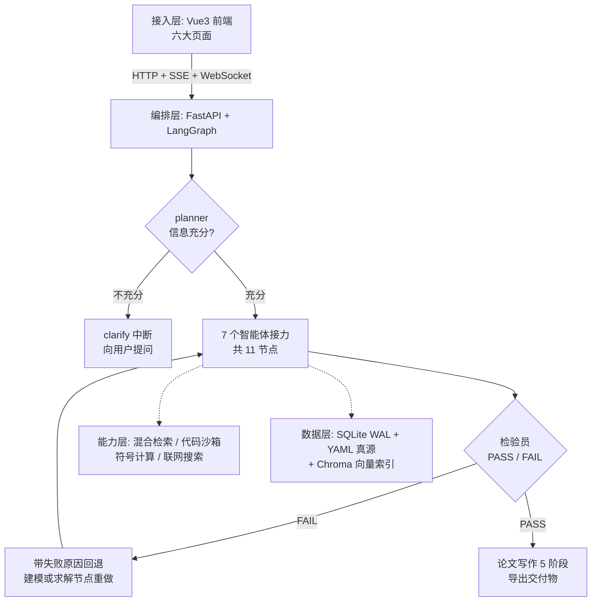

# 复试演示稿 · MathModelAgent（5-8 分钟真机演示 + 答辩预案）

> **2026-10-12 更新**：全部数字口径已与《作品说明（专家阅读版）》（`docs/作品说明_专家阅读版.docx`）和线上代码**逐项实测核对**，修正了三处与代码不符的旧表述（见第〇节）。
> 现场只带一页纸 → [`docs/答辩速查卡.md`](./答辩速查卡.md)。本文件是完整底稿与问答库。
> 团队：一只特立独行的组（张信哲 / 靳舒 / 朱轶笑）　指导教师：赵彦勇　源码：https://github.com/zhang66633/Math_agent

---

## 〇、事实口径核对表（讲错数字比少讲更伤）

| 指标 | **准确口径（实测）** | 旧表述 / 坑 |
|------|----------------------|-------------|
| 智能体 | 7 个智能体角色，编排为 **11 节点**有向图 | 7（角色）与 11（图节点）不是一回事，必须能一句话说清 |
| 知识库 | 86 方法卡 + 32 论文 + 38 真题 + 3 模板 = **159 条目** | `README.md` 仍写 47/16/27，是旧数字，**别引用 README** |
| 学习单元 | **61 个**（建模手 38 / 编程手 13 / 论文手 10） | 单元正文 34 个本地 `.md` + 27 张方法卡内嵌长文（`unit_id` 声明） |
| 题库 | **183 题**（建模手 114 / 编程手 39 / 论文手 30） | — |
| 检索管线 | 查询扩展（可选）→ 向量 + BM25 多路 → 标签高置信置顶 → RRF → MMR → LLM 重排（可选）→ 时间衰减 | 不是「向量检索一下」；重排与扩展默认关闭，高精度路径才开 |
| 论文写作 | 大纲 → **逐章并行**（默认并行度 3）→ 摘要最后写 → 拼装 → 红队审校 → 最小化修订 | ❌ 不要说「固定 12 章节」：章节按求解报告的子问题动态拆分 |
| 测试 | 后端 **24 个测试文件 / 148 个用例** + 前端 **2 文件 / 21 用例**，全绿；CI 前后端都跑 | ❌ 「44 项」= 文件数 + 用例数相加，被追问会露 |
| 编排重构 | nodes.py **1900 行 → 主文件 573 行** + 7 个 agent 各自成模块（`core/agents/`），三份节点映射表合成单一真源 | ❌ 「505 行」是重构当时提交点的快照，现已 573 |
| 沙箱 | subprocess（断网 + 60s 超时 + 512MB 上限）与 Docker 硬隔离双后端 | 默认后端由 `.env` 决定：一键安装写 subprocess，Docker 可用时切 docker |
| 提交 | 全仓库 350 个提交，本轮架构审查与优化 14 个提交留痕 | — |

---

## 一、一句话定位（开场 15 秒讲完）

> 「我们做的是一个数学建模多智能体学习平台。一端是实战：把数学建模从审题到交论文的完整流程，做成七个智能体接力完成，中间有验证和回退；另一端是学习：61 个单元、183 道题、掌握度追踪，教一个新人从零学会建模。两端共用同一份知识库——86 张方法卡、32 篇优秀论文、38 道真题。」

关键词：**多智能体流水线 + 检索增强（RAG）+ 学习闭环**——三个都是真做了的。

---

## 二、设计理念：三个决策，每个都要说「为什么」

**① 流程即智能体，而不是一个万能助手。**
数学建模的标准流程是固定的：审题分析 → 选择模型 → 编程求解 → 验证 → 写论文。我们把它直接映射成七个智能体，各自有独立的系统提示词、工具集与教学风格。
*为什么？* 单 Agent 既要理解问题、又要写代码、还要自我检查，角色互相污染，出错无法定位。拆开后每个环节可验证、可单独回退——求解器产出的代码验证不通过，流水线带着失败原因回退重做，最多三次，错误不会被带进论文。

**② 知识库是弹药库，不是装饰。**
智能体每次分析与建模前，先从知识库检索相关方法卡与优秀论文注入上下文。
*为什么？* 数学建模是知识密集型任务，没有检索增强的大模型会一本正经地编造不适用的模型。检索用多路召回而非单一向量相似度。

**③ 学习与实战同源。**
61 个学习单元的长文，就是知识库里对应方法卡的长文（同一份 YAML 数据、两个视图）；训练场答题记录汇入同一套掌握度模型。
*为什么？* 「学」和「用」必须是同一套知识体系，否则学着 A、用着 B。反过来，训练场答错的知识点会直接影响学习工位推荐的下一个单元。

---

## 三、系统逻辑（三层骨架，专家追问时照这个讲）

三句话版本：
- **接入层**：Vue3 六页面 ── HTTP/SSE/WebSocket ── FastAPI。
- **编排层**：planner 判断信息充分性（不充分就中断提问，不瞎猜）→ 7 智能体 11 节点接力 → 检验 FAIL 则回退重做（≤3 次）→ 写作五阶段。
- **数据层**：**YAML 是知识库唯一真源**，向量索引只是它的投影，删掉一条命令就能全量重建，数据不会丢。

---

## 四、技术创新与特色（这里是得分区，讲慢一点）

### 创新 1：带验证回退的智能体流水线（最经得起追问的一条）

- 检验节点做灵敏度与鲁棒性分析，输出 **PASS / FAIL 结构化判定**；
- FAIL 时按指定目标回退到建模或求解节点，并**把本轮失败原因注入下一轮提示词**；
- 建模节点消费该回退标志，避免验证反复 FAIL 时形成死循环；
- 效果：系统在无人干预下具备自我纠错能力，而不是「一次生成、错也交出去」。

### 创新 2：学习与实战三环数据打通

- 单元完成情况、训练场答题正误、方案模式求解经历，汇入**同一套掌握度模型**；
- 掌握度带艾宾浩斯遗忘衰减，驱动复习提醒与下一单元推荐；
- 61 个单元的长文与知识库方法卡**同源**（同一份 YAML），不是两套内容各写一遍。

### 创新 3：多路融合的混合检索

- 向量语义 + BM25 关键词 + 结构化标签三路召回，多查询变体并行；
- **RRF**（倒数排序融合）合并各路排名 → **MMR**（最大边际相关性）去同质 → **时间衰减**加权；高精度路径再开大模型查询扩展与最终重排；
- 解决的问题很具体：纯向量对专业术语与题号召回差，纯关键词不懂语义；MMR 防止同题多篇论文互相挤占结果位。
- **可现场验证**：搜「辛烷值 优化」，三篇同题论文同时进前列且不互相挤掉。

### 工程加分项（讲一个即可，别贪多）

- **论文写作五阶段**：大纲 → 逐章**并行**撰写（`writing_parallelism=3`，核心章 128K token 预算）→ 摘要最后写（提炼真实结果）→ 红队审校（合规 + 洞察双 gate）→ 最小化修订。把十余次串行大模型调用压成并行。
- **安全是设计出来的**：LLM 生成代码一律沙箱执行（subprocess 断网 / Docker 硬隔离双后端）；markdown 渲染是安全红线，必须过 DOMPurify，并用 XSS 攻击载荷专门测试守护；路径参数防穿越；自定义模型端点经 SSRF 校验拒绝内网；OAuth 带 state 校验。
- **质量有门禁**：后端 148 个用例 + 前端 21 个用例全绿，CI 前后端都跑（ruff / pytest / vue-tsc / biome）。

---

## 五、演示脚本（逐字稿 + 时间轴，7 分钟版）

> 原则：**先定位再演示，每点一下都配一句话**。主演示只走方案模式一条线，其他页面快闪。
> 提前确认：前后端已起、Key 有效（见第九节 Checklist）。

### 第 1 段 · 开场与首页（0:00-0:30）

**动作**：停在首页。
**说**：「这是平台首页，六大入口：对话、方案、学习工位、训练场、成长档案、知识库。一端是实战、一端是学习，两端共用同一份知识库——86 张方法卡、32 篇优秀论文、38 道真题，共 159 条目。」

### 第 2 段 · 主演示：方案模式（0:30-3:10，全场重点）

**动作**：进入方案模式，输入一道真题（推荐 **2023 国赛 C 题·蔬菜类商品的自动定价与补货决策**——知识库里有对应条目，专家可以当场验证检索命中）。
**说（边跑边说，别冷场）**：
- 「我把一道真题直接丢进来。注意右侧时间线——现在 planner 在判断信息是否充分；如果它觉得不够，会停下来反问我，而不是瞎猜。」（若触发 clarify，正好补两句继续）
- 「信息充分后七个智能体开始接力：分析师拆解题型与解法边界；建模师先从知识库检索方法；求解器生成 Python 代码，**在沙箱里真实执行**，图表是算出来的不是编的；检验员做灵敏度与鲁棒性分析——**不通过会带着失败原因回退，让建模或求解重做，最多三次**；最后编辑按五阶段写出论文。」
- 「整个过程通过 WebSocket 实时推送进度，不是一个黑盒等结果。」
- **时间兜底（已实测，务必按此执行）**：2026-10-13 实测这道数据密集真题**端到端约 14 分钟**（13:28 提交 → 13:42 完成），5-8 分钟的答辩**不可能现场等它跑完**。现场节奏必须改成两段式：
  1. **现场提交一道轻量题**，只看它走过前几个节点——实测分类 3 秒、检索 <1 秒、规划 1 秒、分析 13 秒，90 秒内足以展示「planner 判断信息是否充分 + 检索命中 + 时间线实时推送」；
  2. 然后**切到已完成的历史任务**，完整展示 11 节点时间线、**回退标记**、沙箱产出的真实图表、论文初稿与导出。串词：「这道题我刚跑完，我们直接看完整链路的结果。」
  3. 兜底任务已就绪：本机任务 **`bad9118a`**（2023 国赛 C 题，状态 completed，论文 43921 字符，图表 ×2 + CSV 产物）。
  > 若现场必须只讲一条线：**优先讲已完成任务的完整链路**，实时提交只作为「证明它是真在跑」的 30 秒证据。
  >
  > **现场用的轻量题（无数据文件，走 5 节点快路径）建议直接用这句**：
  > 「某车间用两种原料生产三种产品，给出单位利润与资源消耗，求利润最大的生产计划，并分析原料供应量波动对最优解的影响。」
  > 它同时命中「优化 + 灵敏度分析」，正好给检验节点一个做灵敏度分析的理由——**不要现场用带附件的真题**（那类题 14 分钟起步）。

### 第 3 段 · 知识库（3:10-4:00）

**动作**：知识库 → 检索面板，先搜「**蔬菜 自动定价**」（呼应刚才那道题），再搜「**辛烷值 优化**」。
**说**：「大家看到的检索不是关键词匹配——向量语义、BM25 关键词、结构化标签三路召回，RRF 融合、MMR 去同质、时间衰减加权；高精度路径还会加大模型查询扩展与重排。搜『辛烷值 优化』时，三篇同题优秀论文会同时进前列，这就是 MMR 在起作用——不让同一道题的多篇论文互相挤占。」
**加分（时间充裕才做）**：上传一篇 PDF，演示 LLM 提取成结构化 YAML 入库。

### 第 4 段 · 学习中心快闪（4:00-5:00）

**动作**：学习工位（选角色 → 技能树）→ 点开一个单元（长文 + 公式 + 自测）→ 训练场答一题 → 成长档案（热力图、勋章墙）。
**说**：「学习工位按角色铺开 61 个单元，**单元正文就是知识库里方法卡的长文——学和用是同一份数据**。训练场答题自动进错题本、驱动掌握度；档案页有学习热力图和成就。这部分体现的是平台的教育属性，不只是个解题工具。」

### 第 5 段 · 亮点收尾（5:00-5:50）

**动作**：**不点页面，语速放慢，看向老师**。
**说**：「如果用三句话总结这个作品的工程亮点：第一，**编排是真流水线**——检验不通过会带原因回退重做，不是一次生成；第二，**检索是混合管线**——三路召回加融合与去同质，不是搜一下最像的；第三，**质量有门禁**——前后端一百六十多个自动化用例在 CI 里跑，markdown 渲染这类安全红线有专门的攻击载荷测试。全部代码与开发文档都在 GitHub 上，随时可以查。」

### 第 6 段 · 收尾（5:50-6:30）

**动作**：站定，看向老师，不要再看屏幕。
**说**：「我们的演示到这里。这个作品由我们三人共同完成，这次由我代表团队完成演示和答辩——平台架构、后端流水线、知识库与前端主要由我实现，每一部分我都能当场翻代码解释。欢迎各位老师提问。」
> ⚠️ 分工按你的真实情况改，但**必须落到模块名**（第六节有完整话术）。作品说明写的是三人团队，**不要讲成「我一个人做的」**。

---

## 六、单人答辩的节奏与两道必答题

作品说明上写的是三人团队（张信哲 / 靳舒 / 朱轶笑），但**由你一人讲完全程**，所以有两件事必须提前想好。

**① 节奏：靠过场词接住，不要出现长沉默。**
- 方案模式 → 知识库：「流水线还在跑，我们同时看它的弹药库。」
- 知识库 → 学习中心：「检索用的是本地索引，再看平台的教育这一侧。」
- 学习中心 → 收尾：「最后我用三句话总结这个作品的工程亮点。」
- 收尾 → 提问：「我们的演示到这里，欢迎老师提问。」

**② 必答题 A：「这个作品是三个人做的，你负责哪一部分？」**
→ 给出**具体模块名 + 具体工作**，不要含糊：
> 「平台的架构设计、后端多智能体流水线、混合检索知识库与前端界面主要由我实现——包括 11 节点编排与验证回退逻辑、三路召回加 RRF/MMR 的检索链路、沙箱执行与前后端联调；知识与题库内容由我们三人分工整理，部署和测试一起过。我负责的每一部分都能当场翻代码解释。」
（按真实分工改，但**必须落到模块名**，不要只说「一起做的」。）

**③ 必答题 B：「为什么是你一个人来讲？」**
→ 一句带过，不要解释太多：「作品由我们三人共同完成，这次由我代表团队完成演示和答辩。」

> 单人答辩的最大风险不是被问倒，而是**语速失控**：没人替你分担时间。每段讲完停半秒、看一眼计时的人，再进下一段。

---

## 七、专家问答预案（18 问）

1. **七个智能体和直接用一个 GPT 对话有什么区别？**
   流程固化 + 角色分离：每个角色有专属提示词与工具集；环节间有验证与回退；单 Agent 出错无法定位、无法验证。这是「工作流」对「对话」的代差。
2. **到底 7 个还是 11 个？**
   7 个是智能体角色（分析师/建模师/求解器/检验员/编辑/数据预处理与导出）；11 个是 LangGraph 里的节点——除这 7 个 agent 节点外，还有分类、检索、规划、响应格式化四个非 agent 节点。角色是「谁干活」，节点是「图怎么走」。
3. **为什么检索不用纯向量，要搞混合？**
   纯向量对专有名词（EOQ、NSGA-II、题号）召回差；纯关键词不懂语义。三路召回 + RRF 融合兼顾两者；MMR 防止同题多篇互相挤占；时间衰减让新论文优先。现场可验证。
4. **LLM 生成的代码直接执行，安全怎么保证？**
   沙箱双后端：subprocess 断网 + 60 秒超时 + 512MB 内存上限；Docker 容器级硬隔离。另有路径参数防穿越、模型端点 SSRF 校验、DOMPurify 清洗。
5. **数据存在哪？会不会丢？**
   知识库是 YAML 文件（入 git，GitHub 可见）——**唯一真源**；运行时数据 SQLite（WAL 模式）；向量索引只是投影，启动时自动检测缺失并重建。「真源 + 可重建投影」。
6. **测试覆盖了什么？**
   后端 24 个测试文件 / 148 个用例，前端 2 个文件 / 21 个用例，全绿；CI 双 job 跑 ruff + pytest + vue-tsc + biome。markdown 渲染的 XSS 六类攻击载荷有专门测试。
7. **你一个人怎么保证质量？**（团队版可换成「你们怎么保证质量」）
   每改一步先跑测试再提交；架构审查报告（P0/P1/P2 清单）驱动开发，逐项清零；本轮刚做过全项目审查，修掉了卡片 ID 撞车等数据事故。
8. **最难的技术问题是什么？**（真故事，任选一个，讲细节）
   - **BM25 索引陈旧 bug**：单例检索器缓存了建库时的关键词索引，知识库更新后向量能搜到新的、关键词搜不到 → 改成共享检索器 + 失效钩子。
   - **导入流水线同题论文互相覆盖**：三篇同题论文输出文件名相同，后一篇静默覆盖前一篇，而 job 全报成功 → 文件名去重 + 索引失败降级（不再误判为失败）。
   - **虚构模型名导致全部 LLM 调用 404**，降级链路让表面看着正常 → 靠逐层隔离测试定位到模型名配置。
9. **论文写作是怎么并行的？**
   先出大纲，再按大纲逐章并行生成（线程池，并行度可配，默认 3；核心章单独给 128K token 预算）；摘要**最后**写，因为它要提炼正文真实结果；最后拼装 → 红队审校（合规 + 洞察双 gate）→ 最小化修订。任一章节失败则整体失败，保证论文完整。
10. **和市面上的数学建模 AI 工具比，差异在哪？**
    多数是单轮问答/解题；我们是完整流程编排 + 可验证回退 + 知识库增强 + 学习闭环，且**学习数据与实战弹药库同源**。
11. **并发性能怎么样？**（诚实 + 有边界）
    沙箱执行是瓶颈；做了延迟加载（matplotlib 按需导入，启动 1.1s → 0.39s）、检索结果 120 秒 TTL 缓存；目前是单机架构（uvicorn 单 worker + 限并发），水平扩展是后续方向。
12. **为什么用 LangGraph 而不是自己写状态机？**
    它提供中断/恢复（clarify 等用户）、条件边（验证回退）、状态持久化的标准实现，自己写容易在边界条件上出错。另外节点映射表是抽象出来的单一真源，换编排层成本很低。
13. **知识库的 32 篇论文哪来的？**
    公开渠道收集 → 自建导入流水线（PDF 文本提取 → LLM 结构化 → 校验写 YAML → 建向量索引）。导入过程中发现并修掉三个真 bug（文件名覆盖、索引误判、题号提取错误）。
14. **大模型会编造参考文献吗？怎么防？**
    写作提示里明确要求只引用确定真实存在的经典文献，并禁止编造；红队审校阶段会把合规性作为 gate 之一检查。
15. **用户的 API Key 安全吗？**
    Key 只存在本机 `backend/data`（不入 git），用户可在页面自行配置；服务默认只监听 127.0.0.1；自定义模型端点必须 https 且拒绝内网地址（防 SSRF）。
16. **这个项目用了多少第三方框架？会不会被卡脖子？**
    后端 FastAPI + LangGraph，前端 Vue3，向量库 Chroma，都是可替换的开源组件；模型走统一工厂，默认 DeepSeek，任何 OpenAI 兼容接口都能换。
17. **Word 文档里写的和演示一致吗？**
    一致——文档记录的就是这套架构与决策。演示里每个数字都能在代码或接口里当场验证。
18. **下一步计划？**
    一是把单机沙箱做成可水平扩展的执行服务；二是扩充知识库与题库覆盖面；三是把学习闭环的推荐效果做 A/B 验证。

---

## 八、临场规范（对应老师提的四点要求）

- **形象**：纯色有领上衣/干净衬衫，头发别遮眼；不穿拖鞋；不用夸张饰品；手机静音反扣在桌面外。
- **站位**：主讲站屏幕侧前方 45°，绝不挡屏幕；三人横排、主讲居中，其余两位**别插兜、别看手机、别交头接耳**。
- **声音**：比平时大一档，开口前吸一口气；用 **0.5 秒停顿**代替「呃 / 那个 / 然后」；每段最后一句放慢、加重。
- **规范用语**：称呼「各位老师」；被提问先说「谢谢老师，这个问题是这样的」；不用网络词；答完补一句「我说明白了吗」。
- **时间**：一人计时（手机秒表），5:30 用眼神提示主讲；宁可少讲一个亮点，绝不超时。
- **交接**：换人要用一句话承接（见第六节），不要沉默换人、不要抢话。
- **被质疑时**：先复述老师的质疑确认理解（「老师是说 X 这一点吗」），再回答；**不要辩论**。

---

## 九、演示前 10 分钟 Checklist

| 项 | 结论（2026-10-12 实测） |
|----|------------------------|
| 后端 8002 | ✅ `/api/health` 返回 200；启动日志「向量索引已存在，跳过重建」，无需现场建索引 |
| 前端 5174 | ✅ 用 **`http://localhost:5174`**——前端只听 IPv6 localhost，**`127.0.0.1:5174` 连不上** |
| 知识库 | ✅ `/api/knowledge/stats` = 86 方法卡 / 32 论文 / 38 真题 / 3 模板 / 159 条目 |
| 检索实测 | ✅ 搜「蔬菜 自动定价」→ 真题(0.857) + 论文(0.844) + 方法卡；搜「辛烷值 优化」→ 三篇同题论文进前列 |
| 学习系统 | ✅ 单元 61、题库 183（接口实测） |
| 测试 | ✅ 后端 **148** 用例全绿（含新增 5 个提示词渲染回归测试）、前端 21 用例全绿（本机实测） |
| ✅ API Key 有效性 | **已实测可用**：用本机 Key 跑通完整 11 节点流水线，无鉴权报错 |
| ✅ 方案模式端到端 | **已实测跑通**：任务 `bad9118a`（2023 C 题）completed，耗时约 14 分钟，产出论文 43921 字符 + 图表 2 张 + CSV 等产物 —— 这条任务就是现场兜底 |
| ✅ 沙箱 | 实测 Docker 未运行时自动回退 subprocess 并告警，代码照常执行、图表正常出（双后端设计生效） |
| ✅ 回归修复 | 压测发现并修复 planner 提示词渲染崩溃（`KeyError: '"step"'`），新增 5 个回归测试，pytest 148 用例全绿 |
| 备用演示 | 网络断 → 知识库/学习系统仍可演示（本地数据）；方案模式展示已完成任务 `bad9118a` 的时间线与产物 |
| 演示节奏 | 主演示（方案模式）占一半时间，其余快闪；到 5:30 收口 |

---

## 十、两份已交文档与代码不一致时怎么答（重要）

老师手上可能有两份材料，数字口径**互不相同**，且都与你现场说的可能不一样。提前把话说圆：

| 材料 | 其中的数字 |
|------|-----------|
| 《作品使用说明》（原稿） | 方法卡 **47** / 论文 **16** / 真题 **24** / 模板 3；后端测试文件 **22** 个；仓库写 **NB_project**；安装写 install.bat |
| 《作品说明（专家阅读版）》（改善版，后交） | 86 / 32 / 38 / 3 = **159** 条目；自动化测试 **44 项**；nodes.py **1900→505 行** |
| **代码与接口真值（实测）** | 86 / 32 / 38 / 3 = 159；后端 **24 文件 / 148 用例** + 前端 **2 文件 / 21 用例**；nodes.py 现 **573 行**；仓库 **Math_agent** |

**统一答法（主动说迭代，不要辩解）**：
- **知识库数量**：「文档里 47 张是早期版本的数字，之后做了一轮卡片合并与论文、真题的批量导入，现在知识库是 **86 张方法卡 + 32 篇论文 + 38 道真题 + 3 套模板，共 159 条目**，知识库页面当场可查。」
- **测试数量**：「文档里写 44 项，是按当时的测试文件数加前端用例算的；更准确地说，后端 **24 个测试文件里跑了 148 个用例**，加前端 21 个共 **169 个用例**，全部通过，CI 每次提交都跑。」
- **代码规模**：「重构时把 1900 行的编排文件降到 505 行，把 7 个 agent 拆成独立模块；**之后又迭代到 573 行**，主文件只保留编排节点——模块化结构没有变。」
- **仓库地址**：「代码在 **github.com/zhang66633/Math_agent**，旧文档里的 NB_project 是早先的仓库名，已经改名。」
- **安装方式**：「旧文档写 install.bat，现在统一入口是 **`python start.py install`**，一个脚本跨平台。」

> 原则：**数字以现场能验证的为准（知识库页面、接口、测试命令），并主动说明文档反映的是哪个时间点**。这比含糊过去可信得多。
