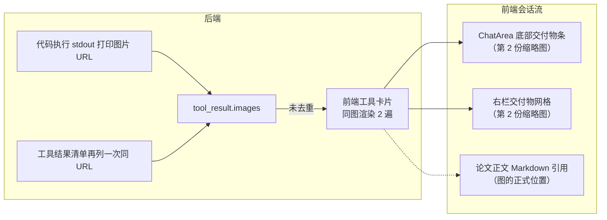
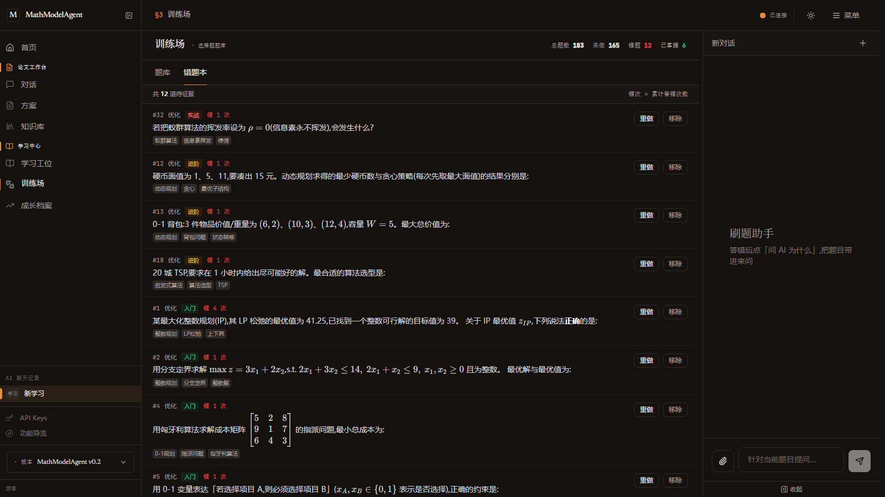
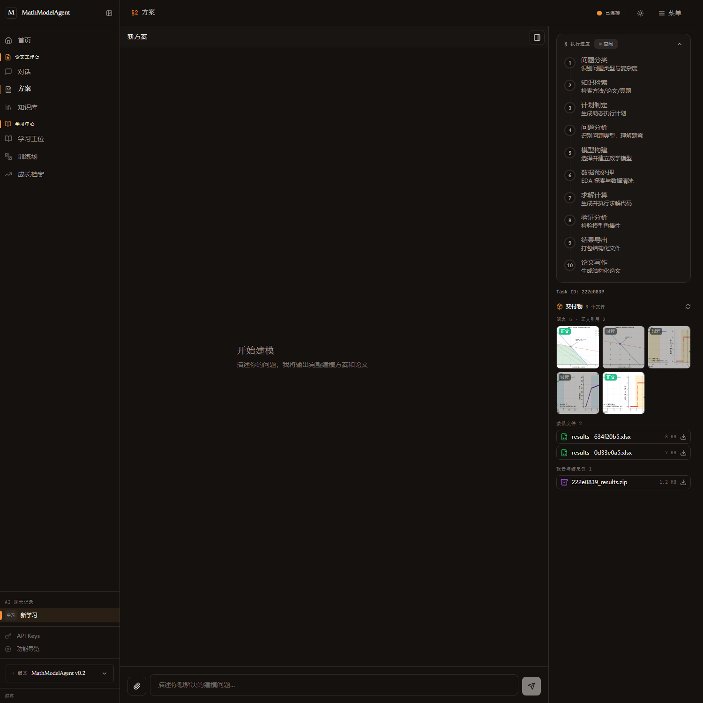

# 方案模式 / 训练场 交互审计（2026-10-13）

> 触发：用户四件事 —— ①学习中心错题页横向拉太长、操作要拖到最右才看得见；
> ②方案模式图片"出现两次"；③思维链/前台直接输出"输出了多少字"很难看；
> ④"还有右侧文件等，总之全面审计一下方案模式，严谨一点"。
>
> 本文档记录：现象 → 根因（含代码位置）→ 修复 → 验证证据 → 未修的与为什么。

---

## 1. 方法与证据来源

| 证据 | 位置 | 用途 |
|------|------|------|
| 真实任务事件流 | `backend/data/task_events/222e0839.jsonl`、`12df70f4.jsonl` | 复现图片重复、`tool_result.images` 重复、node_end 文案 |
| 任务落库结果 | `backend/data/sessions.json` 的 `final_response` | 证明论文引用了**不存在**的图（12df70f4） |
| 任务文件区 | `backend/data/task_files/222e0839/`（mtime 排序） | 证明多轮产物同名不同 hash、导出取错文件 |
| 无头浏览器截图 | Edge `--headless=new --screenshot`，真跑 `localhost:5174` | 目视验收训练场两栏与方案右栏 |
| 单测 | `backend/tests/test_solution_artifacts.py`、`frontend/src/utils/solutionUx.test.ts`、`frontend/src/components/**/*.test.ts` | 把结论钉成回归护栏 |

---

## 2. 问题清单

### P1-1 错题本/题库横向溢出，操作按钮被推到屏幕外

- **现象**：右栏「刷题助手」展开后，错题本表格宽于可视区，要横向拖动才能点到「重做/移除」（用户截图为证）。
- **根因**：`practice/index.vue` 的表格是 auto 布局，`题目` 列按内容的 **max-content** 撑宽
  （题面含行内公式/矩阵块），`truncate` 只裁切、不改变表格的固有宽度；滚动容器因为
  `overflow-y:auto` 在 CSS 规范下把另一轴也算成 auto，于是整块出现横向滚动条。
- **修复**：
  - 错题本由表格改为**卡片列表**：题目列 `min-w-0 flex-1` + 2–3 行截断，
    操作列 `shrink-0` 常驻右侧 → 结构上不可能被挤出去；顺带补了 标签、错次、总数条。
  - 题库/结算表格改 `table-fixed`，题目列吸收剩余宽度并在单元格内截断，
    容器加 `overflow-x-hidden` 兜底；`类别` 列在窄屏 `hidden sm:table-cell`。
  - 省略号必须画在真正装文字的 `
` 上（`[&>p]:truncate`）——只给父元素
    `overflow:hidden` 只会裁切、不会出现 `…`（第一版实测就是这个样子）。

### P1-2 「同一张图出现两次」——其实是三条重复来源

- **根因 1（后端）**：`_collect_image_urls` 用 `re.findall` 全文抓 URL，
  沙箱 stdout 与「生成图表: …」清单各出现一次 → `images` 变成
  `[q2_route.png, q2_route.png]`（12df70f4 事件流实证）。
  修复：`_collect_image_urls` / `_collect_file_urls` 改**去重保序**；
  `interaction_tools.py` 拼文本时同样去重（源头与采集端双保险）。
- **根因 2（前端）**：`RunCodeRenderer` 直接把数组交给 ``；`ChatArea` 的
  交付物条又独立扫一遍工具消息。修复：抽 `utils/toolOutput.ts::collectImageUrls`
  做**唯一**去重入口，两处共用。
- **根因 3（体验）**：同一张图在「执行卡片常驻大图 + 正文再引用一次」中占两屏。
  修复：方案模式下工具卡片图表**默认折叠**成一行 `展开图表（N 张）`（`foldImages`），
  要看原图一点即开——即"第一次的图片折叠进推理过程"；同时关掉方案页底部与右栏重复的
  交付物条（`showArtifacts=false`，右栏已有同批缩略图网格）。

### P1-3 论文引用了不存在的图（破图 + DOCX 里变成一行内部路径）

- **实证**：任务 `12df70f4` 的 `final_response` 含
  ``，而该文件
  在 `solving_output` / `verification_output` / 文件区里**都不存在** ——
  写作模型照抄了"文件名--内容hash.png"的命名规律凭空造了一个。
- **后果**（两处都落在交付物上）：网页阅读器一张破图；DOCX 导出解析不到本地文件时，
  这一行退化成正文文字（实测文本 `图3：图片: /api/task_files/…`），评委翻开就是内部路径。
- **修复**（确定性闸门，不靠再问一次模型）：
  - 新增 `node_helpers.resolve_task_media_path()` 作为**唯一**的 URL→本地路径解析，
    `tasks.py::_resolve_image_path`（DOCX 插图）改为委托它，保证"校验"与"导出"同源。
  - 新增 `strip_missing_image_refs()`：写作定稿前删掉指向不存在文件的图片行，
    并**连带删掉紧随其后的图注**（避免"有图注没图"的悬空描述），返回被删 URL 打日志。
  - `count_paper_structure()` 统计正文 `##/###` 章数与图片引用数，随 node_end 下发。
- **验证**：`test_docx_export_has_no_raw_image_markdown_after_strip` 端到端跑
  `markdown_to_docx`，断言清理前后 `/api/task_files/` 是否出现在 Word 段落里。

### P1-4 前台直接把"输出了多少字"当结果汇报

- **根因**：`stores/task.ts` 非流式节点兜底文案写死
  `求解完成，输出 {n} 字…` / `输出 {n} 字`；`PaperCard` 又显示 `{n} 字`；
  且终态节点 `format_response`（无 title）也会生成一条 `输出 N 字` 气泡——
  实测 222e0839 同时出现两条"输出 40315 字"。
- **修复**：
  - 抽 `utils/taskSummary.ts::describeNodeEnd()`：**只报产物**——
    论文 `7 章 · 6 张图表 · 红队修订完成`、求解 `6 张图表 · 2 个数据表`、
    验证 `模型检验通过`、导出 `已导出 2 个结果文件`；**字符数一律不出现在文案里**
    （`output_length` 只用于判断有没有内容）。
  - `SILENT_NODES = {format_response}`：终态节点不再发重复气泡（正文由论文消息承载）。
  - 后端写作节点补上报 `sections`/`figures`；`PaperCard` 改为显示 `N 章 / N 张图表`。
  - 老任务缺这些字段时优雅退化（有红队结论就报红队结论），不编造字数。

### P1-5 右栏交付物：混堆文件 + 导出取到上一轮的结果

- **根因 A（分组）**：上传附件、xlsx/csv、html 报告、zip 结果包全塞进一个"数据文件"列表；
  同一张图多轮重跑产生的两份文件（`fig3_sens_c--f52a553d` 与 `fig3_sens_c--152a14e6`）
  平铺，用户分不清哪张进了论文。
- **根因 B（导出取错文件）**：`_export_xlsx`/`_export_csv` 用 `sorted(glob)[0]` ——
  持久化文件名是 `原名--内容hash.后缀`，**字典序与生成顺序无关**（222e0839 有两份结果表），
  用户点「Excel」可能拿到上一轮中间结果。
- **修复**：
  - 抽 `components/solution/DeliverablesPanel.vue`：按 **图表 / 数据文件 / 报告与结果包 /
    上传附件 / 文档导出** 五组展示；每张图标注 `正文`（论文真的引用了 URL）或
    `过程`（中间轮次产物，降透明度）；显示文件大小与总数；加"重新拉取"按钮。
  - `_latest_task_file()` 按 **mtime** 取最新一份，xlsx / csv / zip 三个导出统一走它。

### P1-6 侧栏切方案会话时，任务视图不跟着换（跨会话串消息）

- **根因**：`solution/index.vue` 只在 `onMounted` 读一次 `session.taskId`；
  之后切会话只改了 `activeSolutionId`。于是 `displayMessages` 会把**新会话的消息**
  和**上一个任务的进度气泡**拼在一起，右栏继续显示旧任务的图表/文件；
  更隐蔽的是 `syncTaskMsgToSession` 用"当前活动会话"做写入目标，
  任务 A 跑着时切到会话 B，A 的进度就写进了 B（污染持久化数据）。
- **修复**：任务创建时锁定 `taskSessionId`，同步只写归属会话；
  抽出 `applySessionTask(sess)`，`watch(activeSolutionId)` 时对齐
  taskId / 文件区 / 时间线，切到无任务会话则 `taskStore.clearTaskView()`
  （**不关 WS**：任务可能仍在跑，切回来要能接着看）。

### P1-7 论文里同一张图重复插图（验收阶段发现，系统性）

- **现象**：验收时发现 d20f5bee 的论文 7 处图片引用只对应 4 张图；随后用体检脚本
  扫最近 5 篇真实论文，**4 篇都有重复插图**（详见 §4.3）。
- **根因**：并行分章各自拿到同一份全量材料，逐章"用尽每一张图"；
  `prompts/writing.py` 里"同一张图全文只引用一次"的软约束没有约束力。
  更麻烦的是**图号错乱**：同一张图两处编号不同（4.4 / 4.1），两张不同的图共用 4.1。
- **修复**：新增定稿闸门 `dedupe_repeated_image_refs`——只在**确定安全**时删
  （带编号图注 + 与首次出现编号一致 + 无"下图/本图"这类靠位置定位的指代），
  删不了的打 warning 留给红队；红队清单新增第 13 条纠正图号一致性。

### P2 级（顺手修）
| 问题 | 修复 |
|------|------|
| 方案页 `ChatArea` 的「清空 / 新建对话」两个按钮**没绑事件**（点了没反应），标题永远显示"新对话" | 传 `session-title`，接上 `clear`/`new-session` |
| 事件回放推 `final_response_preview` 会**覆盖**本地已拉全的论文（拉全文失败就永久截断） | `final-` 消息禁止被更短内容覆盖 |
| 论文还没生成时点「阅读全文」毫无反馈 | 明确 toast（生成中 / 本任务没有论文正文） |
| 方案页底部交付物条与右栏重复 | `showArtifacts=false`（方案页），chat 页不受影响 |
| 右栏空状态在任务完成后仍说"将显示在这里" | 完成后改说"本任务没有生成文件" |

---

## 3. 改动文件

**前端**

| 文件 | 改动 |
|------|------|
| `pages/practice/index.vue` | 错题本卡片化、表格 `table-fixed`、省略号落位、统计条换行 |
| `pages/solution/index.vue` | 会话-任务对齐、工具栏契约、预览覆盖防护、交付物面板改组件、`fold-tool-images` |
| `components/solution/DeliverablesPanel.vue` | 新增：交付物五分组 + 正文/过程标注 + 尺寸 + 刷新 |
| `components/tool/renderers/RunCodeRenderer.vue` | 图表去重 + `foldImages` 折叠 |
| `components/bubble/BubbleTool.vue`、`BubbleAgent.vue`、`Bubble.vue`、`ChatArea.vue` | `foldImages` / `showArtifacts` 透传；交付物条改用共享去重 |
| `components/paper/PaperCard.vue` | `N 字` → `N 章 / N 张图表` |
| `stores/task.ts` | node_end 文案改写、静默终态节点、`clearTaskView()` |
| `utils/taskSummary.ts`、`utils/toolOutput.ts`、`utils/text.ts` | 新增纯函数（可单测）：文案 / 去重 / 纯文本预览 |

**后端**

| 文件 | 改动 |
|------|------|
| `core/node_helpers.py` | `resolve_task_media_path` + `strip_missing_image_refs`（破图闸门）+ `dedupe_repeated_image_refs`（重复插图闸门）+ `count_paper_structure`；URL 采集去重 |
| `core/agents/writing.py` | 定稿前依次过两道闸门；node_end 下发 `sections`/`figures`/`dropped_image_refs`/`dropped_duplicate_refs`；desc 不再报"字数" |
| `core/prompts/writing.py` | 红队清单新增第 13 条：同一张图只插一次、图号必须前后一致、后续章节用文字交叉引用 |
| `scripts/check_paper_figures.py` | 新增运维脚本：用闸门本身体检任意已落库任务的论文图引用，并统计 DOCX 里残留的内部路径段落数 |
| `core/agents/analysis.py`、`modeling.py`、`solving.py`、`data_preprocessing.py` | 人读字段（`desc` / agent 交接 SystemMessage）统一去掉字符数：长度留在机器字段 `output_length`，文字只讲产物（"模型已建立" / "求解与出图完成 · 图表 4 张"）。字符数留在给 LLM 的工具结果截断提示里——那是对模型说的，不是给人看的 |
| `api/tasks.py` | `_resolve_image_path` 委托共享解析；`_latest_task_file` 供 xlsx/csv/zip 导出取最新 |
| `tools/interaction_tools.py` | 工具结果文本里的图/表/报告 URL 去重保序 |

---

## 4. 验证记录

### 4.1 真机目视（无头 Edge 打本机 dev server，实测数据）

**训练场 · 错题本**（guest 真实 12 道错题）：题目完整可读、`错 N 次` 与
`重做/移除` 常驻卡片右侧，聊天面板展开也不再出现横向滚动条。

**方案模式 · 右栏交付物**（用任务 222e0839 的真实文件清单渲染）：
`交付物 8 个文件 / 图表 5 · 正文引用 2`，绿标 `正文` 与灰标 `过程` 区分开，
`8 KB` / `1.2 MB` 尺寸与「数据文件 / 报告与结果包」分组就位。

### 4.2 端到端实跑（重启后端 + 真实任务）

后端用新代码重启后，通过 API 发了一个真实任务（`d20f5bee`，LP 生产计划 + 灵敏度分析，
走完整的 分类→检索→计划→分析→建模→求解→验证→导出→写作 全链路，约 5 分钟）。

| 检查项 | 结果 |
|--------|------|
| `tool_result.images` 是否还有重复 URL | **重复条目 0**（两次 run_code 各 2 张，全部唯一；修复前同类事件流是 `[x.png, x.png]`） |
| `node_end.writing_agent` 事实字段 | `sections=9, figures=7, dropped_image_refs=[]`，`desc="论文 9 章 · 图表 7 张 · 红队修订完成"` |
| 论文图片引用是否都存在 | 7 处引用、4 张去重图片，**缺失 0 处**（全部指到文件区真实文件） |
| artifacts 登记 | 4 图 + 1 xlsx + 8 csv + 1 zip，分组所需的 `type/size` 都在 |

**实跑纠正了我自己的一处度量错误**：首版 `count_paper_structure` 用 `#{2,3}` 统计，
把这个 `## × 9 + ### × 41` 的论文报成 **"50 章"**——数字不难看，但是错的。
已改为只数二级标题，`PaperCard` 同步；新增单测钉住
（`test_count_paper_structure_counts_chapters_not_subsections`）。
这也说明"端到端实跑"不是走过场：它抓到了单测与代码评审都不会发现的口径错误。

**破图闸门这一轮没被触发**：d20f5bee 的模型没有编造链接（`dropped_image_refs=[]`）。
不满足于"单测覆盖了"——我拿**真实落库论文**把它触发了一遍，见 §4.4。

**新发现（已处理）**：7 处引用只对应 4 张图，同一张图在论文里被引用 2–3 次。
`prompts/writing.py` 早有"同一张图全文只引用一次"的软约束，但**并行分章**
场景下没兜住（各章拿到同一份全量材料）。→ 见 §4.4 的定稿闸门与红队清单第 13 条。

### 4.3 定稿闸门在真实论文上的体检（新增两道确定性闸门）

新增体检脚本 [`backend/scripts/check_paper_figures.py`](../backend/scripts/check_paper_figures.py)：
用**定稿闸门本身**（不是另写一套判断）跑最近 5 篇有论文的真实任务，
给出"如果现在定稿会怎样"，并统计 DOCX 交付物里残留内部 API 路径的段落数。

| 任务 | 图片引用 → 定稿后 | 闸门① 删不存在的引用 | 闸门② 删重复引用 | DOCX 残留内部路径 |
|------|------------------|----------------------|------------------|-------------------|
| d20f5bee | 7 处 / 4 张 → 5 处 / 4 张 | 0 | **2** | 0 → 0 |
| b4a4d714 | 3 处 / 2 张 → 3 处 / 2 张 | 0 | 0（保留，见下） | 0 → 0 |
| 222e0839 | 6 处 / 5 张 → 5 处 / 5 张 | 0 | **1** | 0 → 0 |
| 62b64b79 | 4 处 / 3 张 → 4 处 / 3 张 | 0 | 0（保留，见下） | 0 → 0 |
| 12df70f4 | 3 处 / 3 张 → 2 处 / 2 张 | **1**（编造图） | 0 | **1 → 0** |

**结论一：闸门①在真实交付物上确实生效**。12df70f4 的 DOCX 原本有 1 个段落把
`图3：图片: /api/task_files/12df70f4/q4_pareto--8f3a1c.png` 当正文文字印出来，
过闸门后归零——这是"破图"缺陷在交付物层面的直接证据，不是单测里的构造样例。

**结论二：重复插图是系统性问题，不是某一次抽风**。5 篇里 4 篇有重复插图。

**结论三：重复的那一处不能无脑删**。闸门②的删除条件是四条同时成立
（带编号图注 + 图注编号与首次出现一致 + 图前后无"下图/本图"这类靠位置定位的指代
+ 其他编号引用不构成阻碍），全部来自真实样本的复盘：

- 222e0839 首次出现的图注被 `**…**` 加粗包裹，早期正则不认这个前缀 → 漏删 1 处。
  已修（图注/编号正则容忍强调标记），并补单测。
- 62b64b79 的重复处图注是"图 5.1"、首次是"图 4.2"，正文引用的是 5.1 ——
  删掉会让"图 5.1"在全篇消失 → **保留**。
- b4a4d714 首次出现的图注编号与另一张图撞车（两张都写"图 4.1"），重复处才是"图 4.2"
  且正文引用 4.2 → 删掉同样悬空 → **保留**。
- d20f5bee 有一处重复图的图注被错编成"图 4.1"，而其后正文正好写着
  "图 4.1 中，$y_1^*$（蓝线）…" → 删掉会让这句话指向"可行域图" → **保留**。

也就是说：**能被确定性删除的已经删了；剩下的都是"图号错乱"，属于内容问题**，
不该由文本闸门暗改。为此在红队清单加了第 13 条
（`prompts/writing.py`：同一张图只允许插一次、图号必须前后一致、后续章节用文字交叉引用），
并把"因编号对不上而保留"打成 `logger.warning`，避免"保留 = 没事发生"的错觉。

### 4.4 自动化

- `pytest -q`：**255 passed**（含本次新增 8 条）；1 条
  `test_apikeys_ssrf.py::test_public_https_accepted` 失败，**不是本次改动引入**：
  本机 DNS 把 `api.deepseek.com` 解析成 `198.18.0.89`（代理 fake-IP），
  而工作区里正由另一条会话添加的"DNS 解析级"SSRF 守卫
  （`apikeys._is_disallowed_ip` / `getaddrinfo`，`git show HEAD:...` 确认 HEAD 上还没有）
  按设计拒绝了该地址。属于并发改动 × 本机网络环境的交互，与训练场/方案模式无关。
- `vitest run`：**47 passed**（新增 14 + 3 + 7 条）。
- `vue-tsc --noEmit` 0 error；`biome check src` 0 error；`ruff check` 0 error。
- 真机目视（无头 Edge 打真实 dev server，guest 账号真实数据）：
  - 训练场题库页：所有列（含错次/错题本按钮）在右栏展开时依旧可见，题目列出现 `…`；
  - 训练场错题本页：12 道错题卡片化，`重做/移除` 常驻右侧；
  - 方案右栏（用 222e0839 真实文件清单渲染）：`交付物 8 个文件 / 图表 5 · 正文引用 2`，
    正文与过程徽标、`8 KB`/`1.2 MB` 尺寸、分组标题全部正确。
- 验证用的临时 mock/默认页签改动**已全部还原**（`git diff` 复查无 `TEMP-VERIFY` 残留）。

---

## 5. 未修 / 移交

1. **`/api/task_files/{task_id}/{file}`、`/api/files/{file_id}` 读接口没有属主校验**：
   实测匿名请求可直接取到他人任务目录下的 png（本次截图就是免登录加载的）。
   属于"属主隔离"这条线的范围，本机同时有另一条会话在做 `test_guest_task_ownership`
   级别的审计 —— 不在这里重复改，避免互相覆盖，特此登记。
2. **论文图号一致性（内容问题，非文本闸门能解决）**：3 篇真实论文里存在
   "同一张图两处编号不同 / 两张图共用同一个图号"（62b64b79、b4a4d714、d20f5bee）。
   闸门只能在**确定安全**时删重复插图，剩下的靠红队清单第 13 条纠正；
   想彻底解决需要写作阶段维护"图号注册表"（先分配编号再写正文），属于写作管线改造。
3. **多轮产物全部留在文件区**（过程图/旧结果表）：现在只做"正文/过程"标注与导出取最新，
   没有自动清理。清理策略涉及"用户可能想回看中间结果"，需要单独决策。
4. **`ruff format` / `scripts/` 的历史漂移**：`node_helpers.py` 等 4 个文件在 HEAD 上就
   不符合 `ruff format`；`backend/scripts/` 下 8 个历史脚本有 88 条 `ruff check` 报错。
   两者都不在 CI 门禁内（CI 只跑 `ruff check app tests`），本次不动，避免把无关 diff
   混进提交；若要清理应作为独立提交。
5. **截断策略**：题目列表单行截断仍会切到行内公式（用户可能看到半个矩阵）；
   已用 `title` 提供全文预览，若要更彻底需在列表里把 display math 降级为行内渲染，
   属于渲染管线改动，留待需要时再做。

---

## 6. 教训（写给下一手）

1. **不要用 PowerShell 文本 cmdlet 改 UTF-8 源码**。本次为了合并两处重复正则，
   用 `Get-Content -Raw` + `-replace` + `Set-Content -Encoding UTF8` 回写了
   `node_helpers.py`，中文注释当场变成乱码（同一手法也是 `vite.config.ts` 里那堆
   乱码的来源）。发现后立刻 `git checkout` 回滚、改用编辑工具重做。
   规则：改源码一律用编辑器/编辑工具，PowerShell 只用来跑命令。
   需要脚本化改写时，用 Python 且显式 `encoding="utf-8"` 读写。
2. **"单测全绿"不等于"结果正确"**。章数口径（50 章 vs 9 章）、加粗图注漏删、
   窗口判据过宽，三处问题都是**跑真实数据**才暴露的；构造样例恰好都在我预设的形态里。
3. **判据宁严勿宽**：重复插图删不干净只是版面问题，"删出错误引用"是学术问题。
   凡是判不准的就保留 + 打 warning，让红队/人工接手——这条在真实样本上四次生效。

